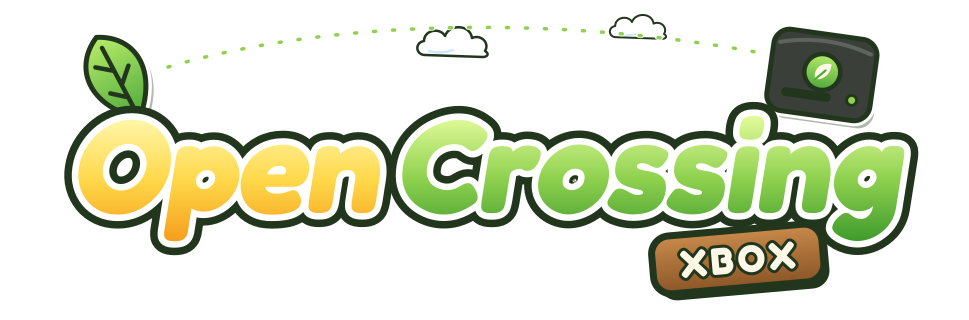

<p align="center">
  
</p>

<p align="center">
  <a href="https://github.com/TechProGabe/OpenCrossing-Xbox/releases/latest"></a>
  <a href="https://github.com/TechProGabe/OpenCrossing-Xbox/releases"></a>
  
  
  
</p>

Animal Crossing for the GameCube, running natively on an original Xbox. No emulator. The game's own decompiled C code is compiled for the Xbox's Pentium III and drawn by its own GPU.

It runs at 60 fps on a stock 64 MB console, at up to 720p, and the NES games in your house work too. The whole game plays and holds up for long sessions, but it's still a port of a decompiled game: expect the odd bug, and save often.

Maintained by [TechProGabe](https://github.com/TechProGabe). Also on [Anbernic handhelds](https://github.com/TechProGabe/OpenCrossing-Anbernic) and the [Dreamcast](https://github.com/TechProGabe/OpenCrossing-Dreamcast).

## What you get

- 480i, 480p or 720p, picked from what your dashboard allows, or pinned in Options.
- 4:3 or 16:9, following the dashboard unless you choose.
- An Options menu drawn in the game's own style, on the title screen and in the pause menu: video, audio, controls (with button remapping) and gameplay.
- Every NES game in your house except Clu Clu Land D.
- Saves in the GameCube `.gci` format: your town moves between the Xbox, Dolphin and the PC port.
- A one-time check of your disc image on first start, so a bad copy is caught right away and not as a crash an hour in.
- Optional screenshots and an FPS counter.

## Install

You need an Xbox that runs homebrew (softmod or modchip), a Duke or Controller S, and your own dump of **Animal Crossing (USA)**, game ID `GAFE01`, Rev 0. `.iso`, `.gcm` and `.ciso` all work, under any file name. PAL, Japanese, e+ and Rev 1 discs are not supported.

1. Grab `OpenCrossing-Xbox-vX.zip` from the [latest release](../../releases/latest) and unzip it.
2. Put your disc image in the `OpenCrossing` folder, next to `default.xbe`.
3. FTP the whole `OpenCrossing` folder to where your dashboard lists games or apps, like `E:\Games\` or `F:\Applications\`. FileZilla works; most dashboards log in as `xbox` / `xbox`.
4. Start OpenCrossing from the dashboard. Look for the leaf.

```
E:\Games\OpenCrossing\
  default.xbe
  default.tbn
  Animal Crossing.iso    (yours)
```

The first start checks every file in your disc image against a known-good copy. It takes a second or two and only happens once per image (press B to skip it for that start). Hold Y and both triggers while the game starts to run it again.

To save space, shrink the 1.4 GB image to the ~28 MB the game reads: `python3 tools/gc_trim_ciso.py "Animal Crossing.iso" AnimalCrossing.ciso`.

**Burning a disc instead:** `tools/make-xiso OpenCrossing/default.xbe "Animal Crossing.iso" OpenCrossing.iso` packs both into a ~35 MB Xbox ISO (needs `bash`, `python3` and [xdvdfs](https://github.com/antangelo/xdvdfs); on Windows, run it from Git Bash or WSL). Burn it as a plain image at low speed. Not every drive reads burned discs: Samsung drives are friendliest, Thomson the fussiest. If yours won't, install to the hard drive.

**xemu:** load the ISO from the step above with Machine > Load Disc and set xemu's memory to 64 MB. Sound works.

## Troubleshooting

When reporting a bug, attach whichever of these exist in `E:\UDATA\4f430001\`: `crash.log`, `hang.log`, `last.log`, `perf.log`, `boot.log`, and their `_prev` copies from the run before. A photo of the screen helps, and so does knowing your cable and any upgrades (RAM, CPU, modchip).

- **"No disc image found":** the image has to sit in the same folder as `default.xbe`, ending in `.iso`, `.gcm` or `.ciso`.
- **"Wrong version of the game" or "This image has been changed":** it isn't a clean USA `GAFE01` Rev 0 dump. The screen names what it found.
- **"This copy doesn't match":** some files differ from a good copy (a damaged or half-copied image). A plays anyway, B quits. Re-copy or re-dump to fix it.
- **Black screen:** some TVs can't show 720p or 480p even when the dashboard allows it. Hold Back while OpenCrossing starts, until the splash goes away: that start runs at 480i and remembers it.
- **Picture squashed or stretched:** widescreen follows the dashboard. Change it there, or pick 4:3 or 16:9 in Options > Video. 720p is always 16:9.
- **No sound:** turn the console fully off and on. After a crash, a reset or IGR can leave the sound chip stuck, and only a power-off clears it.
- **Walking on its own, or menus scrolling by themselves:** raise the dead zone in Options > Controls.
- **128 MB or upgraded consoles:** they work. The game uses 64 MB like a stock Xbox, and upgraded CPUs are detected.

## FAQ

**Do the NES games work?**
Yes, through [fixNES](https://github.com/FIX94/fixNES), since the original emulator is PowerPC assembly. Clu Clu Land D is a Famicom Disk System game and takes you back to the room.

**The gyroid at my door says "I am currently processing data" and won't save. Is saving broken?**
No. That's the gyroid saying no, same as on GameCube. Finish Nook's part-time job or chat with villagers until one remembers you, and saving unlocks.

**What about the Game Boy Advance and e-Reader features?**
An Xbox has no link port, so GBA designs and e-Reader cards don't connect to anything. The island needs no GBA here: Kapp'n rows you over anyway (ask him how).

**Why only the USA disc?**
The decompilation targets `GAFE01`, and the port expects that disc's data. Other releases are detected and refused at start.

**How much RAM does it need?**
A stock 64 MB console. 128 MB consoles run it in 64 MB too, so everyone gets the same game.

## Saves, settings and controls

- **Saves** go to the hard drive, even when you play from a disc: `E:\UDATA\4f430001\save\card_a\`. They're standard GameCube `.gci` files. To bring a town over, export it from Dolphin (a `.gcs` from GameShark or GC Memcard Manager converts with `python3 tools/gcs_to_gci.py mysave.gcs`), start the game once, then FTP the `.gci` into that folder. Any name ending in `.gci` works; a file named exactly `DobutsunomoriP_MURA.gci` always loads first. Every save keeps the last three as `.bak1` to `.bak3`.
- **Visiting other towns** isn't supported: the Porter at the station will explain (and make it up to you). Nook's still grows into Nookington's without a visitor.
- **Options** opens from the title screen, or Settings in the pause menu (Back). Changes apply when you press Apply. Video (output, widescreen, texture filter, FPS counter, screenshots), Audio (volume), Controls (dead zones, rumble, button remapping) and Gameplay (Mr. Resetti, borderless acres, NES aspect). Everything is also in `E:\UDATA\4f430001\settings.ini`.
- **Screenshots:** turn them on in Options > Video, then click the right stick. They land in `E:\UDATA\4f430001\` as `shot00.bmp` and up.
- **Quit Game** on the title screen or pause menu goes back to the dashboard.

| Xbox | GameCube |
|---|---|
| A, B, X, Y | A, B, X, Y |
| Start | Start |
| Black | Z |
| Left / right trigger | L / R |
| Left stick / right stick | control stick / C-stick |
| D-pad | D-pad |
| Back | pause menu |
| Right stick click | screenshot (when turned on) |

Both dead zones start at 40% so a worn stick doesn't walk on its own. A controller in good shape is happier at 15 to 20%: the Controls page shows where your stick rests, so set it just above that.

## Known issues

- At 16:9 some 2D art, like the title logo, is drawn a little too wide.
- On the title screen the menu text is drawn behind the player and the trees.

The full list, with technical detail, is in [docs/known-issues.md](docs/known-issues.md).

## Building

You only need this if you're working on the port. `main` is the release branch and `dev` is where daily work happens, so `dev` can break.

```sh
xbox/build-image.sh   # once: the nxdk SDK image, about 10 minutes
xbox/build.sh         # -> build-xbox/xbe/default.xbe
```

On Windows you can skip Docker: with MSYS2 and nxdk set up (see the header of `tools/xbox/msys/build.sh`), run `tools/xbox/msys/build.sh` from Git Bash. Both need Python 3 with Pillow, and ffmpeg for the boot music. [docs/toolchain.md](docs/toolchain.md) covers xemu and hardware testing; [docs/architecture.md](docs/architecture.md) explains how the port fits together.

## Credits

- **[ACreTeam/ac-decomp](https://github.com/ACreTeam/ac-decomp)**, the full C decompilation of Animal Crossing. None of this exists without it.
- **[flyngmt/ACGC-PC-Port](https://github.com/flyngmt/ACGC-PC-Port)** and its contributors, for the PC port this grew out of: the GX to GL layer, the disc reader, frame-rate fixes, NES support.
- **[FIX94/fixNES](https://github.com/FIX94/fixNES)**, the NES emulator behind the NES furniture.
- **[XboxDev/nxdk](https://github.com/XboxDev/nxdk)**, **[xemu](https://xemu.app)** and **[xdvdfs](https://github.com/antangelo/xdvdfs)**: the open Xbox toolchain, emulator and ISO packer.

AI tools (Claude) helped with the porting work. That covers platform code only, not the decompiled game code.

## Legal

This is an unofficial fan project, not affiliated with or endorsed by Nintendo or Microsoft. Animal Crossing is a trademark of Nintendo and Xbox a trademark of Microsoft, used here only to describe what this works with. No game assets, disc contents or original code are included: the repository holds the decompiled C source (CC0, ACreTeam) and the port code (MIT, see [LICENSE](LICENSE)). You need your own legally obtained copy of the game. Please don't open issues asking for ROMs.
